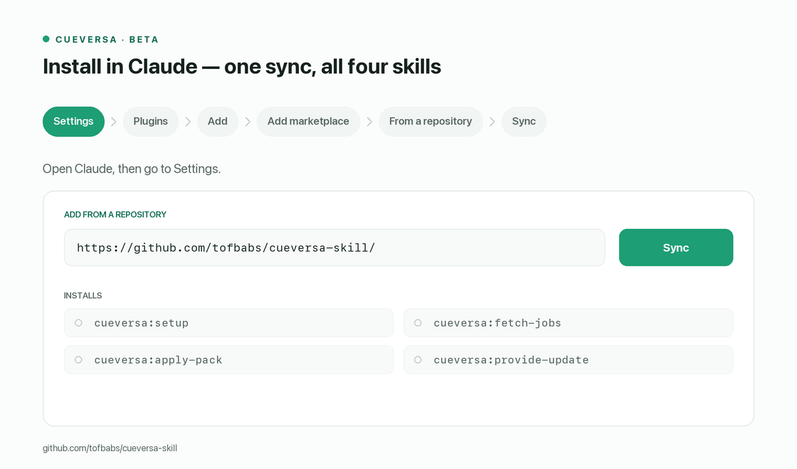

# Cueversa skills

A set of Claude skills that take you from your current CV to a working job-search
pipeline. They help you build a master CV, find roles that fit it, prepare tailored
application packs, and log what happens next.

Everything runs on your own Claude account, your own Notion, and your own Google
Drive. There is no server, no Cueversa account, and nothing proprietary.



## What you get

| Skill | What it does | How it runs |
|---|---|---|
| **setup** | Creates your Notion job board and Drive folders, builds a master CV with you (parse, review, evidence interview), and works out the skills and searches the other skills use | Interactive, run once first |
| **fetch-jobs** | Finds roles on job boards (LinkedIn first) and adds them to your Notion board with a Fit Score against your master CV | Hands-off, can run on a schedule |
| **apply-pack** | Builds a submit-ready pack for each role (tailored CV that passes an ATS check, cover letter, role brief) and moves the card to *Ready to Apply* | Hands-off, can run on a schedule |
| **provide-update** | Logs an outcome from a hiring-team email or an interview transcript and moves the card | Interactive |

**What the skills never do:** submit applications, send emails or messages, or
change anything on a job board. They only read job boards, and everything they
prepare waits for you to review and send.

---

## Before you start (prerequisites)

Check these before you install. Skills that are missing one will stop and tell you
what is wrong rather than guess.

### Required

1. **A paid Claude plan.** Skills are available on Claude Pro, Max, Team and
   Enterprise. On Team and Enterprise, an admin may need to turn skills on for
   your organisation.
2. **Code execution turned on.** In claude.ai go to **Settings → Capabilities**
   and turn on **Code execution and file creation**. Skills need this to run, and
   Cueversa uses it to score roles and render your CV as `.docx` and `.pdf`.
3. **A Notion account, connected to Claude.** Go to **Settings → Connectors**,
   connect **Notion**, and give it access to the workspace where you want your job
   board. Setup creates a *Job Pipeline* board there for you.
4. **A Google Drive account, connected to Claude.** In **Settings → Connectors**,
   connect **Google Drive**. Drive is where Cueversa keeps everything that has to
   last between chats: your config, your master CV, and every application pack.

### Needed for `fetch-jobs`

5. **Claude in Chrome**, with you **signed in to LinkedIn** in that browser.
   LinkedIn has no public jobs API, so Cueversa reads search results through your
   own logged-in browser session. It never types your password and never gets past
   a sign-in wall or security check for you. If you are signed out, it skips
   LinkedIn and tells you.

   You can skip this if you only want to add roles yourself, by pasting a job link
   or description into `fetch-jobs` or `apply-pack`.

### Good to have

- **Your current CV** (a Drive file, a document you upload, or pasted text). You
  can also start from nothing and build the master CV during setup.
- **Scheduled tasks** in Claude, if you want `fetch-jobs` and `apply-pack` to run
  on their own (for example every weekday morning).
- **An interview transcript export** (for example from Granola), if you want
  `provide-update` to log what you were asked and where you were thin.

---

## Install on claude.ai (web, desktop or Cowork)

### 1. Get the skill file

**Download [`cueversa.skill`](https://github.com/tofbabs/cueversa-skill/releases/latest/download/cueversa.skill)**
from the [latest release](https://github.com/tofbabs/cueversa-skill/releases/latest).
No Python, no cloning, nothing to install.

Each release has these files attached:

```
cueversa.skill            <- all four skills in one file (use this one)
cueversa-<skill>.skill    <- the same four skills as separate files, if you prefer
```

They are built automatically by GitHub Actions from the code in this repo, so they
always match the tagged source.

<details>
<summary>Prefer to build it yourself?</summary>

You need Python 3.9 or later and nothing else:

```bash
git clone https://github.com/tofbabs/cueversa-skill.git
cd cueversa-skill
python3 scripts/package.py
```

This writes the same files to a `dist/` folder.

You can also grab an unreleased build of the latest `main` commit: open the
[**Release** workflow runs](https://github.com/tofbabs/cueversa-skill/actions/workflows/release-please.yml),
pick a run, and download the `cueversa-skill` artifact under **Artifacts** (you
need to be signed in to GitHub). It is a zip; unzip it to get the `.skill` files.
Pull requests get the same artifact from the
[**Build skill** workflow](https://github.com/tofbabs/cueversa-skill/actions/workflows/build-skill.yml).

</details>

### 2. Upload it to your Claude account

1. Open [claude.ai](https://claude.ai) and go to **Settings → Customize → Skills**.
2. Click **Upload skill** and choose the `cueversa.skill` file you downloaded.
3. Make sure the skill is switched **on**.

Upload either the single `cueversa.skill` **or** the four `cueversa-<skill>.skill`
files, not both. Both are built from the same source, so they behave the same.

### 3. Run setup

Start a new chat and say:

> Set up Cueversa

Setup walks you through:

1. Creating your Notion job board and your Drive folders (`Cueversa/`, `cv/`, `packs/`).
2. Reading your CV and going through it with you, entry by entry. You can confirm,
   edit, remove, or add anything.
3. A short interview to add numbers and evidence to bullets that need them.
4. Saving your master CV to Drive and suggesting the job searches to run. You
   approve them before anything is saved.

You only do this once. Run it again later to update a single piece, such as your
CV or your searches.

### 4. Use it

Just ask in plain language:

| You say | What runs |
|---|---|
| "Find me new roles" / "Fill my job board" | `fetch-jobs` |
| "What about this role? <link>" | `fetch-jobs` (scores and adds one role) |
| "Prep packs for the top 5" / "Make a pack for this job" | `apply-pack` |
| "I got this email from Acme…" / "Here's my interview transcript" | `provide-update` |

To run sourcing on its own, create a scheduled task with a prompt such as
*"Run Cueversa fetch-jobs, then build packs for the top 3"*.

---

## Install in Claude Code

You need the same Notion and Google Drive access (as MCP servers or connectors)
and, for LinkedIn sourcing, a browser tool such as Claude in Chrome.

```
/plugin marketplace add tofbabs/cueversa-skill
```

```
/plugin install cueversa@cueversa-skills
```

The skills install as `/cueversa:setup`, `/cueversa:fetch-jobs`,
`/cueversa:apply-pack` and `/cueversa:provide-update`. Start with
`/cueversa:setup`.

---

## Where your data lives

On claude.ai, files Claude makes during a chat disappear when the chat ends. So
Cueversa keeps everything that needs to last in **your own Google Drive**:

- `Cueversa/cueversa.config.json`: your settings and the IDs of your board and folders
- `Cueversa/cv/master-cv.json`: your master CV, with a rendered copy beside it
- `Cueversa/packs/Career/NNN_Company_Role/`: one folder per application pack

Your pipeline lives on the Notion board. Each run reads what it needs from Drive,
which is how a scheduled run or a chat tomorrow finds the setup you did today.

The config is looked up in this order: `$CUEVERSA_CONFIG`,
`./cueversa.config.json`, `~/.cueversa/config.json`, then `cueversa.config.json`
in your Cueversa Drive folder.

---

## Troubleshooting

| Message or problem | What to do |
|---|---|
| "You need to run setup first" | Run setup once in a normal chat. Scheduled runs cannot do setup for you. |
| `no config` / `no board` / `no searches` | Setup did not finish. Run it again; it picks up where it stopped. |
| "LinkedIn: user not logged in" | Sign in to LinkedIn in the browser Claude in Chrome uses, then run again. |
| Can't find the Notion board or Drive folder | Check that the Notion and Google Drive connectors are connected and can reach that workspace or folder. |
| No `.docx` / `.pdf` in a pack | Check that code execution is turned on in **Settings → Capabilities**. |
| Skill doesn't trigger | Check that it is switched on in **Settings → Customize → Skills**, and that you uploaded only one version. |

---

## Updating

**claude.ai / Cowork.** Uploaded skills do not update themselves. For each new
release, download the new
[`cueversa.skill`](https://github.com/tofbabs/cueversa-skill/releases/latest/download/cueversa.skill)
and upload it in **Settings → Customize → Skills**, replacing the old one. Watch
the repo (**Watch → Custom → Releases**) on GitHub to be told when there is one.

**Claude Code.**

```
/plugin marketplace update cueversa-skills
```

```
/plugin update cueversa@cueversa-skills
```

The marketplace tracks this repo's `main` branch. A new version is picked up only
when `version` in `plugins/cueversa/.claude-plugin/plugin.json` changes.

---

## For maintainers

**Release flow.** Releases are run by
[release-please](https://github.com/googleapis/release-please). Do not bump
versions or push tags by hand.

1. Write commit messages (or squash-merge PR titles) as
   [Conventional Commits](https://www.conventionalcommits.org/): `fix: …` makes a
   patch release, `feat: …` a minor one, and `feat!: …` or a
   `BREAKING CHANGE:` footer a major one. `docs:`, `chore:`, `ci:` and the like
   do not cause a release on their own.
2. On every push to `main`, the **Release** workflow
   (`.github/workflows/release-please.yml`) opens or updates a release PR named
   `chore(main): release X.Y.Z`. It bumps `version` in
   `plugins/cueversa/.claude-plugin/plugin.json` and updates `CHANGELOG.md`.
3. Merge that PR when you want to ship. release-please tags `vX.Y.Z` and creates
   the GitHub Release, and the same workflow builds the `.skill` files with
   `scripts/package.py` and attaches them to it. Each run also keeps the files as
   a workflow artifact (`cueversa-skill`, or `cueversa-skill-vX.Y.Z` for a
   release).

The current version is tracked in `.release-please-manifest.json` and settings
are in `release-please-config.json`. This repo is its own marketplace with a
local plugin source, so the `version` in `plugin.json` is what makes Claude Code
pick up an update, and release-please keeps it in step with the tag.

One-time repo setting: under **Settings → Actions → General → Workflow
permissions**, turn on **Allow GitHub Actions to create and approve pull
requests**, or release-please cannot open its PR.

To publish a release for a tag made before release-please (such as `v1.0.0`),
or to re-attach files to a release, run **Actions → Build skill → Run workflow**
and enter the tag. Pull requests are built by that workflow too, so a broken
build shows up before it reaches `main`.

### Layout

```
.claude-plugin/marketplace.json      the repo is its own marketplace
plugins/cueversa/
  .claude-plugin/plugin.json
  skills/{setup,fetch-jobs,apply-pack,provide-update}/
scripts/package.py                   builds the .skill archives (four + all-in-one)
.github/workflows/release-please.yml release PRs, tags, releases + .skill assets
.github/workflows/build-skill.yml    builds .skill files on PRs; backfills old tags
release-please-config.json           release-please settings
.release-please-manifest.json        current released version
CHANGELOG.md                         generated by release-please
scripts/merged/SKILL.md              router for the all-in-one cueversa.skill
scripts/make_walkthrough.py          regenerates docs/media/* (macOS, Pillow)
docs/media/                          install walkthrough: animated gif + poster
spike/                               render-toolchain spike (SPIKE.md)
```

### Design

Full design spec:
`docs/superpowers/specs/2026-08-05-cueversa-skills-repo-design.md` (in the
Cueversa monorepo). The knowledge-graph authoring skill `kg-author` stays private
there, generated from `packages/types`.

Standalone today. When the Cueversa app is reachable, scoring and CV
reconciliation use graph mastery instead of the static skills list.
